# 맛집 랭킹 (Restaurant Ranking)

**현재 위치 또는 원하는 지역을 중심으로 주변 음식점을 검색하고 비교하는 반응형 웹 서비스**

Kakao Maps로 음식점 위치를 표시하고, Google Places API로 음식점 정보를 조회합니다. 사용자는 카테고리, 평점, 리뷰 수, 거리 등을 기준으로 음식점을 비교하고 Google Maps에서 상세 정보를 확인할 수 있습니다.

- **배포 사이트:** https://ranking-map.vercel.app
- **GitHub:** https://github.com/singthesong2/Ranking-Map
- **개발 형태:** 개인 프로젝트
- **개발 기간:** [2026.10.11 ~ 2026.11.26]

## 목차

- [프로젝트 소개](#프로젝트-소개)
- [주요 기능](#주요-기능)
- [기술 스택](#기술-스택)
- [프로젝트 파일 구조](#프로젝트-파일-구조)
- [API 구성](#api-구성)
- [실행 방법](#실행-방법)
- [환경 변수](#환경-변수)
- [주요 화면](#주요-화면)
- [트러블슈팅](#트러블슈팅)
- [프로젝트 회고](#프로젝트-회고)

## 프로젝트 소개

사용자가 현재 위치나 검색한 지역 주변의 음식점을 지도와 목록에서 함께 확인하고, 조건에 맞는 음식점을 비교할 수 있도록 제작했습니다.

기획부터 UI 구현, 외부 API 연동, 위치 기반 검색, 반응형 대응 및 테스트까지 개인적으로 진행했습니다. 데스크톱은 REZERVI, 모바일은 Stfalcon의 레스토랑 UI를 디자인 레퍼런스로 참고했습니다.

## 주요 기능

### 위치 및 음식점 검색

- Geolocation API를 이용한 현재 위치 조회
- 지역 검색 및 지도에서 검색 기준 위치 지정
- 검색 반경과 음식점 카테고리 선택
- 음식점 이름·키워드 검색
- 음식점 유형 및 제외 조건을 이용한 검색 결과 필터링
- 키워드 검색 시 페이지 토큰을 이용한 추가 결과 조회 지원(API 및 커스텀 Hook)

### 지도와 랭킹

- Kakao Maps에 현재 위치, 검색 위치, 음식점 마커 및 검색 반경 표시
- 추천순, 평점순, 리뷰순, 거리순 정렬
- 음식점 이름, 주소, 평점, 리뷰 수 및 예상 도보 시간 표시
- 마커 호버 정보창 및 터치 환경용 음식점 미리보기 카드
- 음식점 선택 시 Google Maps 상세 페이지로 이동
- 검색 결과 로딩·오류·재시도 UI

### 사용자 편의 기능

- 즐겨찾기 등록 및 해제, 즐겨찾기 목록
- 최근 검색 기록 관리 및 검색 조건 공유 기능
- 위치 권한 안내, 토스트 알림, 확인 모달
- 데스크톱·태블릿·모바일 반응형 UI
- CSS Safe Area를 활용한 iPhone 노치·홈 인디케이터 영역 대응
- `prefers-reduced-motion`을 활용한 사용자 모션 감소 설정 대응

> 예상 도보 시간은 좌표 간 거리 기반 추정치이며 실제 도보 경로를 계산한 값은 아님.

## 기술 스택

| 구분             | 사용 기술                             | 역할                                                                |
| ---------------- | ------------------------------------- | ------------------------------------------------------------------- |
| 프레임워크       | Next.js (App Router), React           | 화면 구성, 서버 API Route                                           |
| 언어             | TypeScript                            | 컴포넌트 및 데이터 타입 관리                                        |
| 스타일           | Tailwind CSS, Wanted Sans             | 반응형 UI, 웹폰트                                                   |
| 전역 상태        | Zustand                               | 지도, 즐겨찾기, 검색 기록, 토스트 상태                              |
| 데이터 패칭      | TanStack Query                        | API 요청, 캐싱, 키워드 검색 페이지 관리                             |
| 데이터 저장      | localStorage                          | 브라우저 내 데이터 저장                                             |
| 데이터 검증      | Zod                                   | 검색 기록 및 공유 검색 데이터 스키마                                |
| 지도             | Kakao Maps JavaScript SDK             | 지도, 마커, 검색 반경 표시                                          |
| 장소 데이터      | Google Places API                     | 음식점 검색 및 장소 정보 조회                                       |
| 접근성/기기 대응 | CSS Safe Area, prefers-reduced-motion | iOS 안전 영역 및 사용자 모션 감소 설정 대응                         |
| 최적화           | Debounce (Custom Hook)                | 지역·음식점 검색어 입력 및 검색 반경 변경 시 불필요한 API 요청 감소 |
| 기타             | Geolocation API, Tabler Icons React   | 위치 조회, 아이콘                                                   |
| 개발 및 배포     | Git, GitHub, Vercel                   | 버전 관리, 디버깅, 배포                                             |

## 프로젝트 파일 구조

주요 소스 파일을 기준으로 정리했습니다. 각 파일의 역할은 간단히 표시했습니다.

```text
rankingmap/
├── app/                                  # Next.js App Router
│   ├── api/                              # 서버 API Route
│   │   ├── place-details/
│   │   │   └── route.ts                  # 장소 ID 기반 음식점 정보 조회
│   │   ├── restaurant-search/
│   │   │   └── route.tsx                 # 음식점 키워드 검색 및 페이지 토큰 처리
│   │   └── restaurants/
│   │       └── route.tsx                 # 주변 음식점 카테고리별 검색·필터링
│   ├── globals.css                       # 전역 스타일
│   ├── icon.svg                          # 파비콘
│   ├── layout.tsx                        # 공통 레이아웃 및 메타데이터
│   ├── loading.tsx                       # 페이지 로딩 UI
│   ├── not-found.tsx                     # 404 페이지
│   ├── opengraph-image.tsx               # 소셜 공유 이미지
│   ├── page.tsx                          # 메인 페이지
│   ├── providers.tsx                     # TanStack Query 및 토스트 연결
│   ├── robots.tsx                        # 크롤링 관련 설정
│   └── sitemap.tsx                       # 사이트맵
│
├── components/                           # UI 컴포넌트
│   ├── CategoryFilter.tsx                # 음식점 카테고리 필터
│   ├── ConfirmModal.tsx                  # 확인 모달
│   ├── FavoriteButton.tsx                # 즐겨찾기 버튼
│   ├── FavoriteDetailsSkeleton.tsx       # 즐겨찾기 정보 로딩 UI
│   ├── FavoritesPanel.tsx                # 즐겨찾기 패널
│   ├── FullPageLoading.tsx               # 전체 화면 로딩 UI
│   ├── Header.tsx                        # 헤더
│   ├── LocationPermissionNotice.tsx      # 위치 권한 안내
│   ├── MapControls.tsx                   # 지도 관련 제어 UI
│   ├── MapErrorState.tsx                 # 지도 오류 및 재시도 UI
│   ├── MapSection.tsx                    # 지도 및 조작 기능
│   ├── RankingList.tsx                   # 음식점 랭킹 목록
│   ├── RankingListSkeleton.tsx           # 랭킹 목록 로딩 UI
│   ├── RestaurantMarkerPreview.tsx       # 터치 환경 마커 미리보기
│   ├── RestaurantSearchSkeleton.tsx      # 음식점 검색 로딩 UI
│   ├── SearchBox.tsx                     # 검색 입력 UI
│   ├── SearchHistoryList.tsx             # 최근 검색 기록 목록
│   └── ToastViewport.tsx                 # 전역 토스트 표시
│
├── docs/
│   └── screenshots/                     # README 스크린샷
│       ├── category-search.png
│       ├── desktop-main.png
│       ├── favorites.png
│       ├── location-permission-denied.png
│       ├── map-error.png
│       ├── marker-preview-desktop.png
│       ├── marker-preview-mobile.png
│       ├── mobile-main.png
│       ├── not-found.png
│       ├── region-search-history.png
│       ├── restaurant-list-error.png
│       └── restaurant-search-history.png
│
├── font/
│   └── WantedSansVariable.woff2          # 로컬 가변 폰트
│
├── hooks/                                # 커스텀 Hook
│   ├── useClickOutside.tsx               # 외부 클릭 감지
│   ├── useCountdownRedirect.tsx          # 카운트다운 후 이동
│   ├── useCurrentlocation.tsx            # 현재 위치 조회
│   ├── useCurrentLocationMarker.tsx      # 현재 위치 마커
│   ├── useDebounce.tsx                   # 디바운스 처리
│   ├── useKakaoMapLoader.tsx             # Kakao Maps SDK 로딩 및 지도 초기화
│   ├── useOutsideClick.tsx               # 외부 클릭 감지
│   ├── useRelativeTime.tsx               # 상대 시간 계산
│   ├── useRestaurantMarkers.tsx          # 음식점 마커 및 이벤트 처리
│   ├── useRestaurants.tsx                # 음식점 데이터 조회
│   ├── useRestaurantSearch.tsx           # 키워드 검색 및 페이지별 결과 관리
│   └── useSelectedRestaurantMarker.tsx   # 선택된 음식점 마커 처리
│
├── public/                               # 지도 마커 SVG
│   ├── restaurant-pin-blue.svg
│   ├── restaurant-pin.svg
│   ├── search-pin.svg
│   └── select-location-pin.svg
│
├── schemas/                              # Zod 스키마
│   ├── searchHistorySchema.ts            # 검색 기록 데이터 검증
│   └── shareSearchSchema.ts              # 공유 검색 데이터 검증
│
├── stores/                               # Zustand 전역 상태
│   ├── useFavoritesStore.ts              # 즐겨찾기
│   ├── useMapStore.ts                    # 지도 및 검색 위치
│   ├── useSearchHistoryStore.ts          # 최근 검색 기록
│   └── useToastStore.ts                  # 토스트 알림
│
├── types/
│   └── restaurant.ts                     # 음식점 및 카테고리 타입
│
└── utils/                                # 공통 함수
    ├── calculateDistance.ts              # 거리·예상 도보 시간 계산
    ├── regionSearch.ts                   # 지역 검색 관련 처리
    ├── restaurantClassifier.ts           # 음식점 분류 및 제외 필터
    ├── shareSearch.ts                    # 검색 조건 공유 처리
    └── siteUrl.ts                        # 사이트 URL 처리
```

## API 구성

외부 Google Places API 요청은 Next.js 서버 API Route에서 처리합니다. 각 경로는 사용 목적에 따라 분리했습니다.

| Method | 경로                     | 역할                                                   |
| ------ | ------------------------ | ------------------------------------------------------ |
| GET    | `/api/place-details`     | 장소 ID로 음식점 이름·주소·좌표·Google Maps 링크 조회  |
| POST   | `/api/restaurant-search` | 음식점 키워드 검색, 이름 필터링, 다음 페이지 토큰 반환 |
| POST   | `/api/restaurants`       | 위치·반경·카테고리별 주변 음식점 조회 및 필터링        |

### 검색 처리 방식

- **키워드 검색 (`/api/restaurant-search`)**: Google Places **Text Search**를 이용해 검색하고, 장소 이름에 검색어가 포함되는 결과를 반환합니다. `nextPageToken`을 이용한 추가 조회를 지원합니다.
- **주변 검색 (`/api/restaurants`)**: 일반 카테고리는 **Nearby Search**, 샤브샤브·마라탕·고기집·치킨·카레 등 일부 카테고리는 **Text Search**를 사용합니다. 음식점 분류 및 제외 조건으로 결과를 필터링합니다.
- **장소 조회 (`/api/place-details`)**: 장소 ID로 필요한 정보를 조회하고, 필수 데이터와 좌표를 확인한 뒤 결과를 반환합니다.

### TanStack Query를 이용한 키워드 검색

- 검색어·좌표·반경을 `queryKey`로 관리
- `nextPageToken`을 다음 요청의 `pageToken`으로 전달할 수 있도록 구성
- 페이지별 결과를 합치고 음식점 ID 기준 중복 제거
- `AbortSignal` 전달을 통한 요청 취소 지원

## 실행 방법

```bash
# 1. 저장소 복제
git clone https://github.com/singthesong2/Ranking-Map

# 2. 프로젝트 폴더로 이동
cd rankingmap

# 3. 의존성 설치
npm install

# 4. 환경 변수 설정 (.env.local 생성)

# 5. 개발 서버 실행
npm run dev
```

브라우저에서 `http://localhost:3000`으로 접속합니다.

```bash
npm run build   # 프로덕션 빌드
npm run start   # 프로덕션 서버 실행
```

## 환경 변수

프로젝트 루트의 `.env.local`에 설정합니다. API 키의 실제 값은 README나 저장소에 올리지 않습니다.

```dotenv
NEXT_PUBLIC_KAKAO_MAP_KEY=카카오_JavaScript_앱_키
GOOGLE_PLACES_API_KEY=구글_Places_API_키
```

| 변수명                      | 사용 목적                               |
| --------------------------- | --------------------------------------- |
| `NEXT_PUBLIC_KAKAO_MAP_KEY` | 클라이언트에서 Kakao Maps SDK 로딩      |
| `GOOGLE_PLACES_API_KEY`     | Next.js 서버에서 Google Places API 요청 |

`NEXT_PUBLIC_` 접두사가 있는 값은 클라이언트에 노출될 수 있으므로 Kakao 개발자 콘솔에서 허용 도메인을 설정해야 합니다. Google Places API 키는 서버 환경 변수로 관리합니다.

## 주요 화면

### 데스크톱 메인 화면

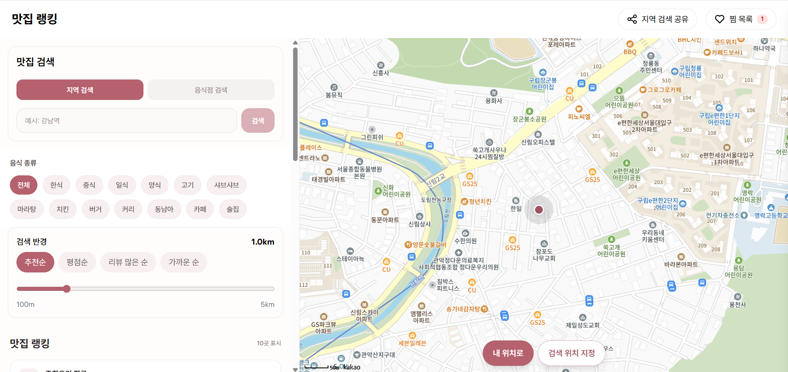

### 모바일 메인 화면

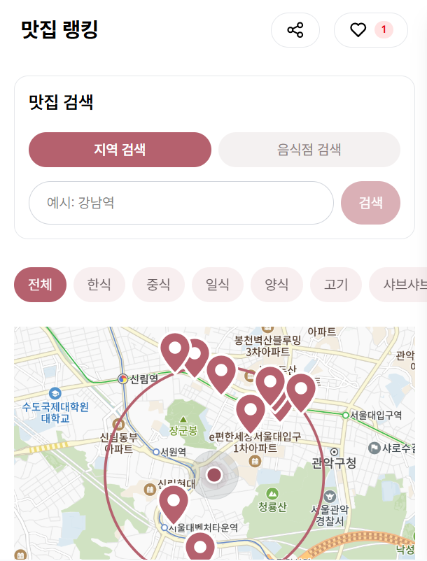

### 카테고리별 음식점 검색

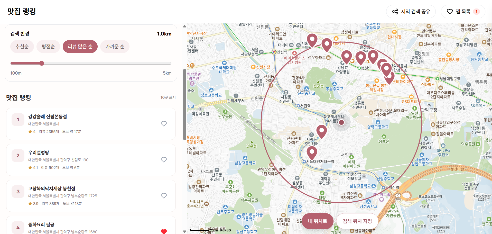

### 지도 마커 미리보기

**데스크톱 — 마커 호버 시 음식점 정보 표시**

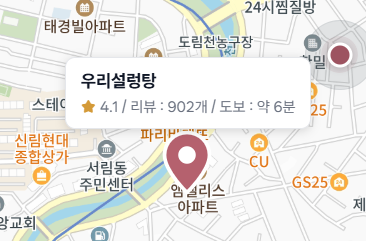

**모바일·태블릿 — 마커 선택 시 음식점 미리보기 카드 표시**

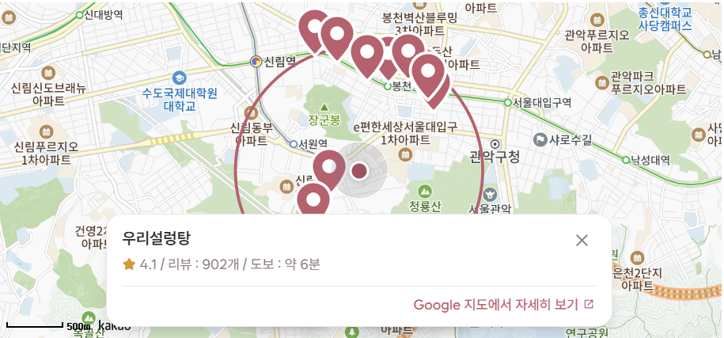

### 즐겨찾기

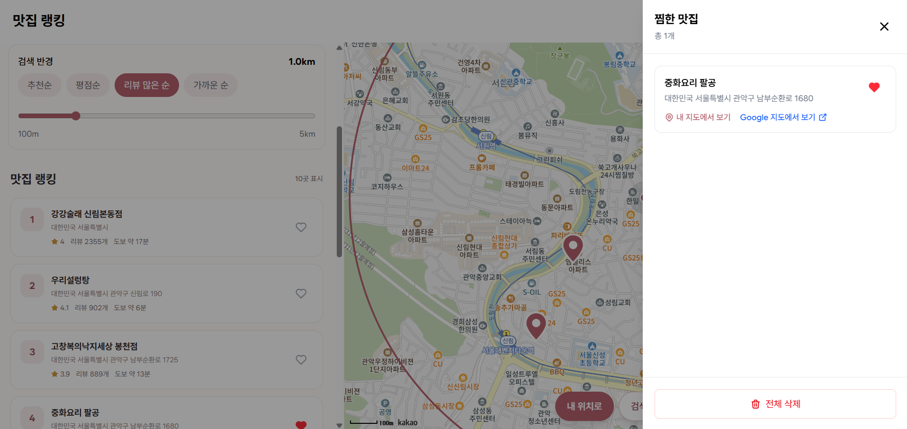

### 검색 기록

**지역 검색 기록**

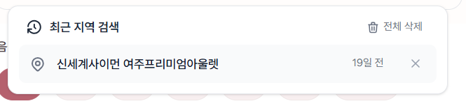

**음식점 검색 기록**

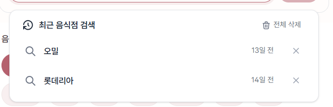

## 예외 상황 처리 화면

### 404 페이지

존재하지 않는 경로에 접근했을 때 안내 화면을 표시합니다.

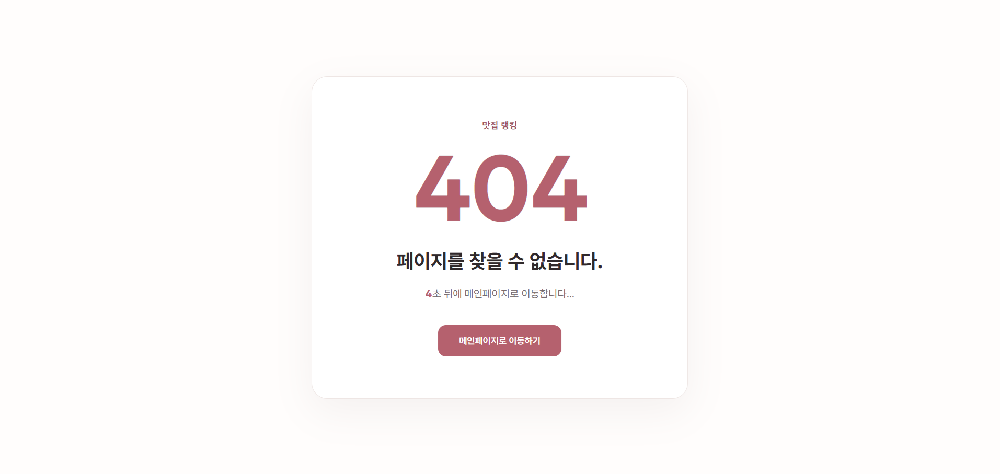

### 위치 권한 거부

현재 위치 접근이 차단된 경우 사용자에게 위치 권한 관련 안내를 제공합니다.

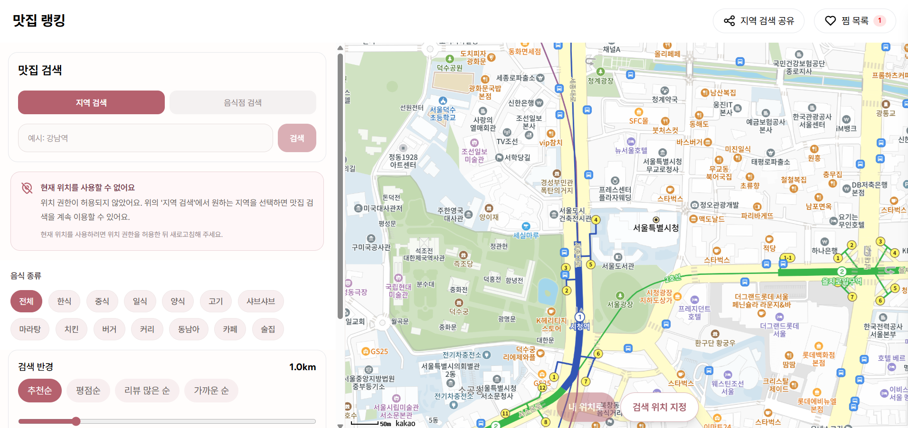

### 음식점 목록 조회 실패

음식점 데이터 요청이 실패했을 때 오류 메시지와 재시도 버튼을 표시합니다.

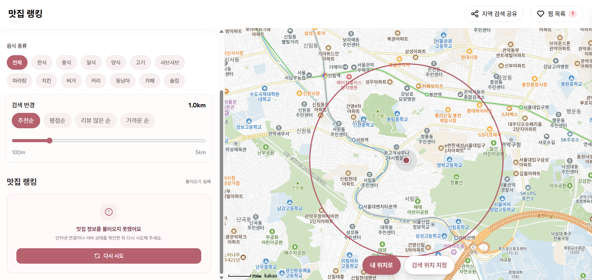

### Kakao Maps 로딩 실패

지도 SDK를 불러오지 못하면 지도 오류 안내와 재시도 버튼을 표시합니다.

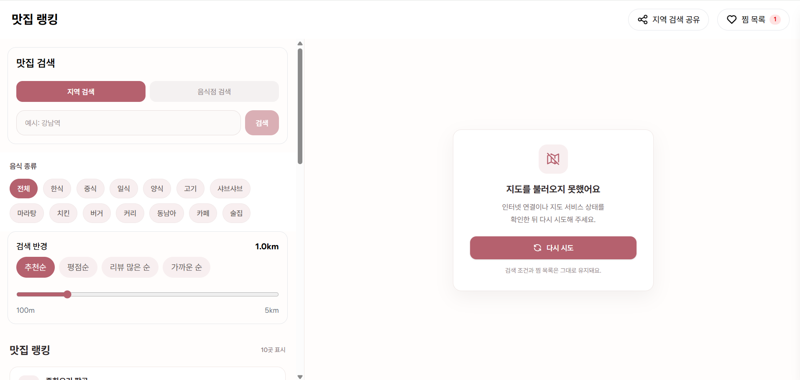

## 트러블슈팅

### 1. 현재 위치가 실제 위치와 다르게 표시되는 문제

- **문제:** 개발 환경에서 Geolocation API가 실제 위치와 다른 좌표를 반환했습니다.
- **확인 및 조치:** Chrome의 위치 제공 방식을 확인하고 설정을 변경해 실제 위치에 가까운 좌표가 반환되는 것을 확인했습니다.
- **배운 점:** 위치 정확도는 애플리케이션 코드뿐 아니라 브라우저 및 기기 환경의 영향을 받을 수 있습니다.

### 2. 음식점 검색 결과에 음식점이 아닌 장소가 포함되는 문제

- **문제:** 경기도 여주에서 테스트했을 때 음식점 목록에 자전거 매장이 표시됐고, 일부 카페 검색에는 방탈출·보드게임 카페 등이 포함됐습니다.
- **해결:** 장소 유형과 제외 조건을 이용하는 `restaurantClassifier` 필터링 로직을 적용했습니다.
- **배운 점:** 외부 API 응답도 서비스 목적에 맞게 검토하고 가공해야 합니다.

### 3. 터치 환경에서 음식점 마커 정보를 확인하기 어려운 문제

- **문제:** 데스크톱의 마우스 호버 정보창은 모바일·태블릿에서 동일한 방식으로 사용하기 어렵습니다.
- **해결:** 호버가 가능한 환경에서는 정보창을, 터치 환경에서는 마커 선택 시 음식점 미리보기 카드를 표시하도록 구분했습니다.
- **배운 점:** 반응형 UI는 화면 크기뿐 아니라 입력 방식도 고려해야 합니다.

### 4. Kakao Maps 초기 로딩과 Lighthouse 분석

- **문제:** 모바일 Lighthouse에서 지도 영역이 LCP 요소로 측정됐습니다.
- **분석:** Chrome DevTools로 지도 SDK 및 이미지 요청 시점을 확인하고 리소스 우선순위와 지도 초기화 방식을 검토했습니다.
- **결과:** 시도한 변경만으로는 큰 성능 개선이 확인되지 않았습니다. 최적화는 추측보다 측정 결과를 바탕으로 진행해야 한다는 점을 확인했습니다.

## 프로젝트 회고

### 배운 점

Next.js와 TypeScript 환경에서 지도 SDK 및 외부 장소 데이터 API를 연결하고, UI·서버 API·상태 관리·커스텀 Hook의 역할을 나누어 구현했습니다. 실제 위치에서 서비스를 테스트하며 검색 데이터와 모바일 상호작용의 문제를 발견하고 수정한 경험이 의미 있었습니다.

### 아쉬운 점 및 개선 방향

국내 사용자에게 친숙한 네이버·카카오의 장소 정보를 활용해 더욱 다양하고 상세한 음식점 정보를 제공하고 싶었지만, API 이용 비용과 개발 예산을 고려해 Google Places API를 선택했습니다. Google Places API 역시 호출량과 조회 정보에 따른 과금 부담으로 검색 결과 수와 제공 정보를 제한해야 했던 점이 아쉬웠습니다.
향후에는 API 비용과 사용량을 고려하면서 더 많은 음식점을 검색하고, 사용자에게 유용한 상세 정보를 제공할 수 있도록 개선하고 싶습니다.

## 참고 자료

- [Kakao Maps API](https://apis.map.kakao.com/)
- [Google Places API](https://developers.google.com/maps/documentation/places/web-service/overview)
